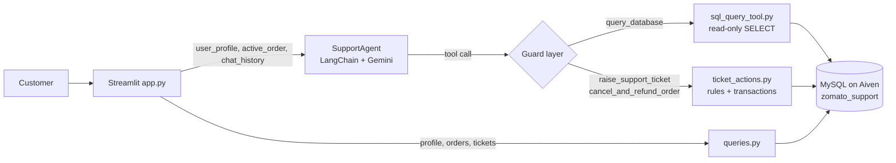
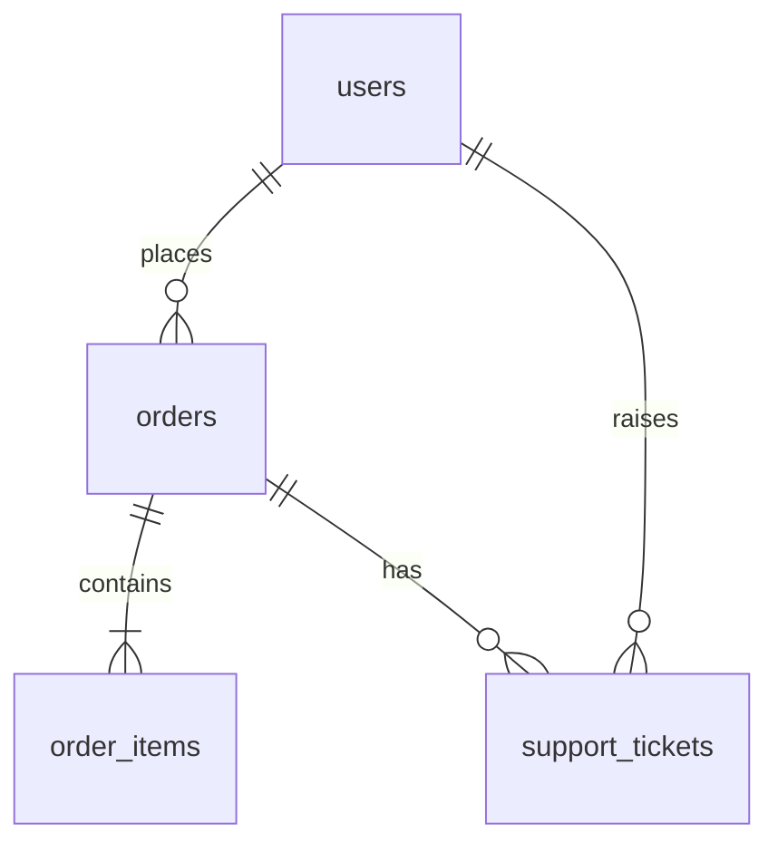

# Zomato AI Customer Support

A chat-first customer support bot modelled on Zomato's in-app support chat, with a similar look and flow but a smaller feature set. A Streamlit front end talks to a LangChain + Google Gemini agent, which reads and writes a transactional MySQL database hosted on Aiven. The agent handles live order tracking, delay complaints, cancellations with refunds, missing-item and food-quality disputes, ticket status, and escalation to a human agent.


## Overview & Goals

Food-delivery support ranges from simple status checks ("Where is my food?") to financial resolutions ("Refund my missing item"). Unstructured documents or key-value stores cannot verify that an item was really in an order, or compute a refund accurately. This project pairs a conversational LLM with a normalized relational database so that every answer and every action is grounded in real data.

The project aims to:

- Identify customers by **user ID** (no password flow) and greet them by name.
- Show a **live order** (or the most recent orders, with a "more" option) as soon as the chat opens.
- Offer **quick actions that depend on the order status**, exactly as a real support bot would.
- Enforce business rules **in code**, not only in the prompt, so the model can never refund a missing item before delivery or cancel an order that is already out for delivery.
- Keep an audit trail of tickets, issue types and refund amounts.
- Stay lightweight (~5 MB database) for local MySQL 8.4 LTS and Aiven's free tier.

---

## Features

**Chat experience**
- Login by user ID on a red, Zomato-style page with a hero illustration.
- WhatsApp-style bubbles: rounded corners, timestamps, maximum 75% width, auto-scroll to the latest message.
- Greeting by name, then a live order or recent orders ("Show more" for older ones).
- Support tickets are reached only through **More options** or by typing, never forced on screen.
- Light / dark theme toggle at the top right, with theme-safe colours.

**Layout**
- Left sidebar: customer name, customer ID, phone, the "Need help with your order? / Ask Zomato AI" card, and shortcuts (My orders, My support tickets, Main menu).
- Centre: the chat.
- Right panel: order details (restaurant, items, status, ETA, delivery partner name and phone).

**Support logic**
- Status-driven quick actions (cancel, track, call delivery partner, missing item, food quality, refund status, talk to an agent).
- Delay detection for live orders older than 45 minutes.
- Automatic cancel-and-refund with a full refund for `placed` / `preparing` orders.
- Item-level missing-item refunds computed from `order_items`.
- Duplicate-ticket prevention.

---

## UI Preview

### Light mode


### Dark mode


---

## Tech Stack & Environment

| Layer | Technology |
| :--- | :--- |
| Front end | Streamlit **>= 1.40** (custom HTML/CSS bubbles, one small JS helper for scrolling and height fitting) |
| Agent | LangChain (`langchain_core`, `langchain_google_genai`) with Google Gemini (tool calling) |gemini-3.5-flash-lite
| Database engine | MySQL 8.4 LTS |
| Hosting | Aiven managed MySQL (SSL required) |
| DB access | SQLAlchemy + PyMySQL, connection pooling, `pool_pre_ping` |
| Management client | MySQL Workbench |
| Database name | `zomato_support` |
| Language | Python 3.10+ |

---

## System Architecture



**Request flow**

1. The customer logs in with a user ID. `app.py` loads the profile and orders from `queries.py`.
2. The UI shows the greeting and either the live order or recent orders. Choosing an order loads its full details into `active_order`.
3. Free text or a quick-action pill is sent to `SupportAgent.chat()` with the profile, active order and history.
4. The agent builds a system prompt (status policies, order context, existing tickets), calls Gemini, and runs any requested tools, for up to 5 iterations.
5. Every tool call passes through `_guard_tool_call`, then the business rules in `ticket_actions.py`, before touching the database.
6. The reply is rendered as a bubble and the order panel is refreshed.

---

## Project Structure

```text
zomato-ai-support/
├── app.py                      # Streamlit UI and chat flow (main entry point)
├── requirements.txt            # Python dependencies
├── .env                        # Secrets (never commit)
├── README.md                   # This file
├── .streamlit/
│   └── config.toml             # Streamlit theme and toolbar settings
├── certs/
│   └── ca.pem                  # Aiven CA certificate for SSL
├── config/
│   └── settings.py             # Loads and validates environment variables
├── docs/
│   ├── ui_light.png            # Light mode screenshot
│   └── ui_dark.png             # Dark mode screenshot
├── sql/                        # Database scripts (names as in the original setup)
│   ├── zomatoDB_create.sql
│   ├── zomatoDB_insert.sql
│   ├── zomatoDB_verify.sql
│   └── zomatoDB_insertCustomerTickets.sql
└── src/
    ├── agents/
    │   ├── support_agent.py    # Gemini agent, tools, tool-call guards
    │   └── prompts.py          # System prompt and context builders
    ├── database/
    │   ├── connection.py       # SQLAlchemy engine for Aiven MySQL
    │   ├── queries.py          # Read helpers used by the UI and agent
    │   └── schema_metadata.py  # Schema description for the agent
    └── tools/
        ├── sql_query_tool.py   # Safe read-only SQL executor
        └── ticket_actions.py   # Ticket creation and cancel-and-refund logic
```

---

## Database Architecture

A 4-table relational schema with foreign keys and cascading deletes.



### Table Details

| Table | Purpose | Why It Exists |
| :--- | :--- | :--- |
| **`users`** | Customer master | Stores profiles. `user_id` is the primary key used to identify the customer when a chat starts. |
| **`orders`** | Order tracking & logistics | Holds order status (`placed`, `preparing`, `out_for_delivery`, `delivered`, `cancelled`), timestamps, delivery partner details and ETA. |
| **`order_items`** | Line-item food data | Maps dishes, quantities and prices to each order, so item-level complaints can be verified and refunds computed accurately. |
| **`support_tickets`** | Ticket log & resolution | Records issue type, ticket status, bot summary and refunded amount for every support interaction. |

### Key Columns

| Table | Columns used by the application |
| :--- | :--- |
| `users` | `user_id`, `name`, `phone` |
| `orders` | `order_id`, `user_id`, `restaurant_name`, `order_status`, `total_amount`, `placed_at`, `eta_minutes`, `delivery_partner_name`, `delivery_partner_phone`, `cancellation_reason` |
| `order_items` | `order_id`, `item_name`, `quantity`, `unit_price` |
| `support_tickets` | `ticket_id`, `order_id`, `user_id`, `issue_type`, `ticket_status`, `bot_summary`, `refund_amount`, `created_at` |

**Allowed values**

- `order_status`: `placed`, `preparing`, `out_for_delivery`, `delivered`, `cancelled`
- `issue_type`: `order_delay`, `missing_item`, `food_quality`, `cancellation`, `agent_escalation`
- `ticket_status`: `open`, `resolved_bot`, `escalated_to_agent`

---

## Data Generation & Setup

Mock data was generated with an automated stored procedure (`GenerateZomatoMockData`) so queries run against realistic distributions instead of empty tables.

### Volume
- **2,000 users** with unique IDs, names and Indian phone numbers.
- **5,000+ orders** linked to users across realistic segments.
- **12,000+ order items** (1 to 4 distinct items per order).

### Distribution Logic
- **User activity segments**
  - *New / inactive (IDs 1-300):* 0 orders.
  - *Casual (IDs 301-1400):* 1 to 3 orders.
  - *Frequent (IDs 1401-2000):* 4 to 8 orders.
- **Order lifecycles**
  - `delivered` (70%): historical orders over the past 30 days.
  - `out_for_delivery` (10%): active, with delivery partner name and phone.
  - `preparing` (10%): active, in kitchen preparation.
  - `placed` (5%): fresh orders, eligible for immediate cancellation.
  - `cancelled` (5%): logged with cancellation reasons.
- **Pricing:** each order's `total_amount` is the sum of its `order_items`.

### Run the Setup Scripts Locally

Open MySQL Workbench (or the `mysql` client) and run the scripts in this order:

```sql
SOURCE zomatoDB_create.sql;
SOURCE zomatoDB_insert.sql;
SOURCE zomatoDB_verify.sql;
SOURCE zomatoDB_insertCustomerTickets.sql;
```

---

## Business Rules by Order Status

The order status decides what the bot offers and what the backend allows.

| Status | Quick actions offered | Allowed | Blocked |
| :--- | :--- | :--- | :--- |
| `placed` / `preparing` | Track order, Cancel order, Delay help, Talk to an agent | Tracking, `order_delay` ticket, **cancel with full refund** | Missing item, food quality |
| `out_for_delivery` | Track order, Call delivery partner, Delay help, Talk to an agent | Tracking, rider contact, `order_delay` ticket | **Cancellation**, missing item, food quality |
| `delivered` | Missing item, Food quality, Refund / ticket status, Talk to an agent | `missing_item` (refund = unit price x quantity), `food_quality` (no refund) | Cancellation, `order_delay` |
| `cancelled` | Refund status, Talk to an agent | Looking up the cancellation ticket | New cancellation, missing item |

Additional rules:

- **Delay:** a live order placed more than **45 minutes** ago is treated as delayed (`DELAY_THRESHOLD_MINUTES` in `prompts.py`).
- **Refund cap:** a refund can never exceed the order total.
- **No duplicates:** an open ticket of the same type for the same order blocks a new one.
- **Ownership:** an order must belong to the logged-in customer.

These are enforced in `ticket_actions.py` and `support_agent.py`, so they hold even if the model misbehaves.

---

## Agent Tools & Safety Guards

| Tool | What it does |
| :--- | :--- |
| `query_database` | Runs a read-only `SELECT` for order, user or ticket details. |
| `raise_support_ticket` | Creates a ticket after validating the order, status, refund amount and duplicates. |
| `cancel_and_refund_order` | Cancels a `placed` / `preparing` order and logs a full-refund ticket in one transaction. |

**Guards (`SupportAgent._guard_tool_call`)**

- Ticket and cancel calls are rejected when no order is selected.
- The `order_id` must equal the order the customer selected; the `user_id` is overwritten with the logged-in user (the model's value is never trusted).
- `query_database` must reference the customer's own `user_id` or the selected `order_id`, and cannot contain multiple statements.
- The tool loop is capped at 5 iterations, and tool errors are returned to the model as plain text.

---

## Configuration (`.env`)

Create a `.env` file in the project root. The exact variable names are read in `config/settings.py`; keep them in sync with that file. A typical setup:

```env
# Gemini
GEMINI_API_KEY=your_google_ai_studio_key
MODEL_NAME=gemini-flash-model-name

# Aiven MySQL
DB_HOST=your-service.aivencloud.com
DB_PORT=12345
DB_USER=avnadmin
DB_PASSWORD=your_password
DB_NAME=zomato_support
DB_SSL_CA=certs/ca.pem
```

Download the CA certificate from the Aiven service overview page and save it as `certs/ca.pem`.

---

## Installation & Running the App

```bash
# 1. Clone and enter the project
cd zomato-ai-support

# 2. Create a virtual environment
python -m venv venv
source venv/bin/activate        # Windows: venv\Scripts\activate

# 3. Install dependencies (Streamlit must be >= 1.40)
pip install -r requirements.txt

# 4. Add your .env and certs/ca.pem (see Configuration)

# 5. Run the app
streamlit run app.py
```

Open the URL Streamlit prints (usually `http://localhost:8501`), then log in with a user ID. Good test IDs are **1401-2000** (frequent customers with several orders). IDs **1-300** have no orders.

---

## Testing Each Layer

Run these from the project root, in this order:

```bash
python -m src.database.connection        # confirms the Aiven SSL connection
python -m src.database.queries           # profile, orders, tickets
python -m src.tools.ticket_actions       # module loads
python -m src.agents.support_agent       # sends a sample "Where is my food?" to Gemini
```

Then test the full flow in the UI, for example:

1. A `delivered` order: report a missing item, expect a ticket with the item refund.
2. An `out_for_delivery` order: ask to cancel, expect a polite refusal and the rider's number.
3. A `placed` order: cancel, expect a full refund and the status changing to `cancelled`.

---

## Hosting & Setting Up the Database on Aiven

### Step 1: Provision a Managed MySQL Service

Create a MySQL service in the Aiven Console and note:
- **Host**
- **Port**
- **User:** `avnadmin`
- **Password**

### Step 2: Import the Backup via CLI

```bash
cd "C:\Program Files\MySQL\MySQL Server <VERSION>\bin"

mysql --user=<DB_USER> -p --host=<DB_HOST> --port=<DB_PORT> defaultdb < "path/to/backup.sql"
```

### Step 3: Create the Dedicated Application Database

1. Open your Aiven MySQL dashboard.
2. Select the **Databases** tab.
3. Click **Add database**.
4. Enter `zomato_support` and confirm.

### Step 4: Migrate Tables to the Application Database

Move the tables from `defaultdb` with an atomic rename:

```bash
mysql --user=<DB_USER> -p --host=<DB_HOST> --port=<DB_PORT> -e "RENAME TABLE defaultdb.order_items TO zomato_support.order_items, defaultdb.orders TO zomato_support.orders, defaultdb.support_tickets TO zomato_support.support_tickets, defaultdb.users TO zomato_support.users;"
```

### Step 5: Verify the Migration

```bash
mysql --user=<DB_USER> -p --host=<DB_HOST> --port=<DB_PORT> -e "SHOW TABLES FROM zomato_support; SHOW TABLES FROM defaultdb;"
```

> **Note:** `defaultdb` stays in Aiven as an empty system database required for internal platform health checks.

---

## Managing and Updating Records via MySQL Workbench

### Step 1: Configure the Connection

1. Open MySQL Workbench and click **+** to add a connection.
2. Enter your **Host**, **Port** and **Username**.
3. Set **Default Schema** to `zomato_support`.
4. In the **SSL** tab, select **Require**.
5. Test and save the connection.

### Step 2: Edit or Insert Records

1. Expand `zomato_support` in the **Schemas** panel.
2. Right-click a table (for example `support_tickets`).
3. Choose **Select Rows - Limit 1000**.

**To update:** double-click a cell, type the new value, press **Enter**.

**To insert:** scroll to the bottom row marked `*`, fill in the values, and leave auto-increment keys blank.

**To save:** click **Apply** (bottom right), review the generated SQL, then click **Finish**.

---

## Limitations & Notes

- **SQL scoping is heuristic.** `query_database` checks that the query contains the customer's `user_id` or the selected `order_id` as a number. It blocks multi-statement queries and unrelated queries, but it is not a full SQL parser. For production, use a database user with read-only rights and parameterised views.
- **Delay threshold.** The 45-minute rule is a simple tunable constant. Seeded orders with old timestamps may appear as "delayed" until you refresh the data.
- **No session persistence.** Chat history lives in Streamlit `session_state` and is lost on refresh.
- **Login by ID only.** This is intentional for the demo; it is not authentication.
- **Mock data.** All customers, riders and phone numbers are synthetic.
- **LLM variability.** Wording may vary between runs; the allowed actions do not, because the rules live in code.

---

## Security Notes

- Never commit `.env` or `certs/ca.pem`. Add both to `.gitignore`.
- Rotate the Gemini key and the Aiven password if either was ever shared or pushed.
- The app talks to Aiven over SSL; keep the connection set to **Require**.
- Use a least-privilege database user for the app where possible.

---

## File Reference

### Application

**`app.py`**
- The main Streamlit entry point: login page, sidebar, chat area and order-details panel, with light/dark theming.
- Controls the chat flow: greeting, live or recent orders, status-based quick actions, "More options", and ticket view.
- Calls the agent for free-text messages and refreshes the order panel after each action.

**`requirements.txt`**
- Lists the Python packages needed (Streamlit, LangChain, Google Gemini integration, SQLAlchemy, PyMySQL, python-dotenv).
- Install everything at once with `pip install -r requirements.txt`.
- Keep Streamlit at version 1.40 or newer for the UI features used.

### Configuration

**`config/settings.py`**
- Loads environment variables from `.env` into a single `settings` object.
- Holds the Gemini API key, model name and database connection details.
- `settings.validate()` fails early with a clear message if something is missing.

**`.streamlit/config.toml`**
- Sets the Streamlit base theme (light) and the primary colour `#E23744`.
- Uses a minimal toolbar so the page looks like an app, not a dashboard.
- Must live in a folder named `.streamlit` (with the leading dot) at the project root.

**`.env`**
- Stores secrets: Gemini API key and Aiven database credentials.
- Read at start-up by `config/settings.py`.
- Must never be committed to version control.

**`certs/ca.pem`**
- The Aiven CA certificate used to verify the SSL connection to MySQL.
- Referenced by `src/database/connection.py` when the engine is created.
- Download it from the Aiven service page; it is not a secret but is environment-specific.

### Agent

**`src/agents/support_agent.py`**
- Defines the `SupportAgent` class that talks to Gemini and loops over tool calls (maximum 5).
- Registers the three tools: `query_database`, `raise_support_ticket`, `cancel_and_refund_order`.
- Guards every tool call, pinning it to the logged-in customer and selected order.

**`src/agents/prompts.py`**
- Holds the system prompt with the status-based policies (tracking, cancellation, missing items, food quality, escalation).
- Builds the order and ticket context blocks that are injected into each prompt.
- Defines the live statuses and the 45-minute delay logic.

### Database

**`src/database/connection.py`**
- Creates and caches the SQLAlchemy engine for Aiven MySQL over SSL.
- Configures pooling and `pool_pre_ping` so stale connections are recovered.
- Exposes `get_engine()` to every other database module.

**`src/database/queries.py`**
- Contains the read helpers: user profile, orders (with items), live orders, order details, open tickets, tickets for an order.
- Converts `Decimal` and `datetime` values into JSON-friendly types for the UI and agent.
- Used by `app.py` to build the greeting, order lists and the order panel.

**`src/database/schema_metadata.py`**
- Describes the tables and columns in plain text.
- Gives the agent the schema it needs to write correct `SELECT` queries.
- Keep it in sync if the schema changes.

### Tools

**`src/tools/ticket_actions.py`**
- `create_support_ticket` validates ownership, status-vs-issue rules, refund cap and duplicates before inserting.
- `process_cancellation_refund` cancels `placed` / `preparing` orders and records a full-refund ticket in one transaction.
- Enforces business rules in code, so they hold regardless of what the model says.

**`src/tools/sql_query_tool.py`**
- Runs read-only SQL for the `query_database` tool.
- Rejects anything other than a `SELECT` statement.
- Returns rows in a compact form the model can read.

### SQL Scripts

**`zomatoDB_create.sql`**
- Creates the `zomato_support` schema and the four tables with keys and constraints.
- Defines column types and allowed status values.
- Run this first.

**`zomatoDB_insert.sql`**
- Seeds the data using the `GenerateZomatoMockData` procedure (2,000 users, 5,000+ orders, 12,000+ items).
- Applies the activity segments and status distribution described above.
- Run it after the create script.

**`zomatoDB_verify.sql`**
- Runs sanity queries: row counts, status distribution and total-amount checks.
- Confirms the seed data matches the expected volumes.
- Safe to re-run at any time.

**`zomatoDB_insertCustomerTickets.sql`**
- Adds sample support tickets for chosen customers.
- Lets you test ticket status and duplicate prevention straight away.
- Run it last.

### Documentation

**`docs/ui_light.png` and `docs/ui_dark.png`**
- Screenshots of the chat UI in light and dark mode.
- Embedded at the top of this README.
- Replace them whenever the UI changes.

**`README.md`**
- Explains the project goals, architecture, database, rules, setup and hosting.
- Doubles as the runbook for Aiven and MySQL Workbench.
- Update it whenever files, tables or rules change.
- 
### Streamlit deployed link
- https://zomatosupportaichatbot.streamlit.app/
